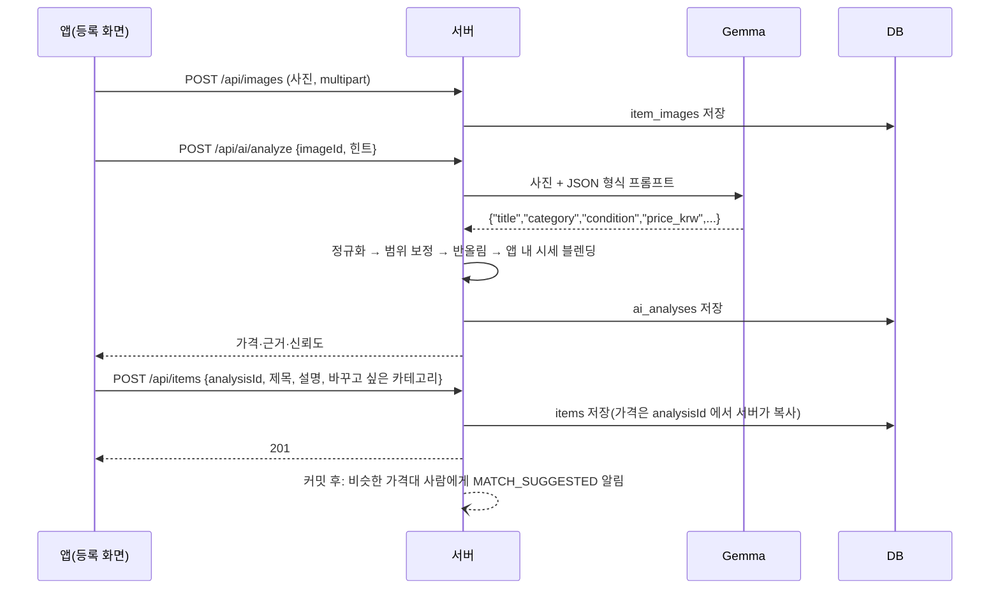
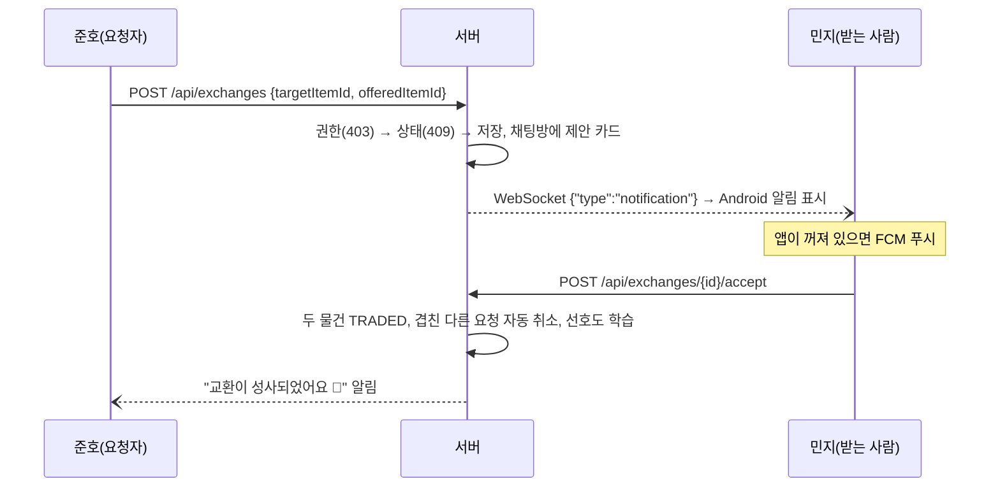

# 스바다 아키텍처

> 한 문장 소개(12장 1.1): **"안 쓰는 물건을 사진으로 찍으면 AI(Gemma)가 값을 매기고, 비슷한 값의 물건과 바로 바꿔 주는 물물교환 앱"**

## 1. 3계층 구조 (교재 1장)

```mermaid
flowchart LR
  subgraph APP["① 앱 계층 — Flutter (Android 에뮬레이터)"]
    UI[screens/ 화면 14개] --> REPO[repositories/]
    REPO --> API[network/api_client.dart<br/>HTTP + JSON + JWT]
    REPO --> RT[network/realtime_client.dart<br/>WebSocket]
    RT --> NOTI[services/local_notifier.dart<br/>→ MainActivity.kt 알림 표시]
  end

  subgraph SERVER["② 서버 계층 — Spring Boot 4 · Java 21 (127.0.0.1:8097)"]
    SEC[auth/ JWT 필터 · SecurityConfig] --> CTRL[Controller]
    CTRL --> SVC[Service<br/>item · exchange · chat · recommend · ai · notification]
    SVC --> JPA[Repository<br/>Spring Data JPA]
    WS[realtime/ WebSocket 핸들러 · RealtimeHub] --> SVC
  end

  subgraph DATA["③ 데이터 계층"]
    H2[(H2 파일 DB<br/>./data/sbada)]
    FILES[[./data/uploads<br/>사진 파일]]
  end

  subgraph EXT["외부 서비스"]
    GEMMA[Gemma 4<br/>Google AI Studio 또는 로컬 Ollama]
    FCM[FCM 푸시<br/>(선택)]
  end

  API -- "REST /api/**<br/>Authorization: Bearer JWT" --> SEC
  RT -- "ws://10.0.2.2:8097/ws?token=JWT" --> WS
  JPA --> H2
  SVC --> FILES
  SVC -- 사진 + 프롬프트 --> GEMMA
  SVC -- 앱이 꺼져 있을 때 --> FCM
```

에뮬레이터 안에서 `10.0.2.2` 는 개발 PC의 `127.0.0.1` 을 가리킨다(10장 2.5). 서버는 `127.0.0.1` 에만 열어 같은 와이파이의 다른 기기가 접속하지 못하게 했다(7장).

## 2. 교재와의 대응표

| 교재 | 배운 것 | 스바다에서 쓴 곳 |
|---|---|---|
| 1장 3계층·HTTP·JSON | 앱·서버·DB 역할 분리, 상태코드 | 위 그림, `ErrorResponse {code, message}` 형식 |
| 1장 6절 폴링·SSE·WebSocket·푸시 | 상황에 맞는 실시간 방식 고르기 | 채팅 = **WebSocket**(양방향), 앱이 꺼져 있을 때 = **푸시(FCM)**, 알림함 첫 로딩 = REST |
| 2장 Flutter 환경 | 에뮬레이터, `flutter run` | `scripts/setup-app.bat`, `run-app.bat` |
| 3장 Spring Boot 환경 | Gradle, `bootRun` | `scripts/run-server.bat` |
| 4장 DB·인증 | 테이블 설계, H2 콘솔, JWT, 비밀번호 해시 | `docs/database.md`, BCrypt, HS256 JWT |
| 5장 UI 설계 | 화면 흐름, 상태별 화면 | 온보딩 → 홈 → 상세 → 바로 바꾸기 / 채팅, 하단 탭 4개(`docs/ui.md`) |
| 6장 Java·Dart 구조 | Controller-Service-Repository, 모델 클래스 | 서버 패키지 구조, `lib/models/` |
| 7장 CRUD·JWT | 등록자는 토큰에서, 서버가 정하는 값은 본문에서 거절 | 가격·상태·등록자를 본문에 넣으면 **400 UNKNOWN_FIELD** |
| 8장 권한·상태 API | 401·403·404·409 규칙, 권한을 먼저 확인 | 교환 수락은 받은 사람만(403), 끝난 요청 재처리 409 (`docs/state-rules.md`) |
| 9장 Flutter 화면 | 목록·상세·폼 | `lib/screens/` |
| 10장 서버 연동·JWT 로그인 | `http` 패키지, 토큰 저장, `--dart-define` | `api_client.dart`, `session.dart`, `config.dart` |
| 11장 오류 처리·통합 테스트 | 연결 안 됨/타임아웃 구분, 재시도, 중복 요청 | `api_exception.dart`, 버튼 중복 탭 방지, JUnit·MockMvc·WebSocket 테스트 |
| 12장 발표 | 2분 발표, 입력-처리-출력 설명 | `docs/demo-script.md` |

## 3. 서버 패키지

| 패키지 | 역할 |
|---|---|
| `auth` | 가입·로그인, JWT 발급·검증 필터, 공개/보호 API 구분 |
| `user` | 내 정보, **온보딩 선호 저장**, **선호도 학습**(`PreferenceService`) |
| `image` | 사진 업로드(5 MiB, 파일 시그니처로 PNG/JPEG만 허용 → 아니면 415), 파일 저장·조회 |
| `ai` | **Gemma 가격 분석** — 프롬프트, Google/Ollama 클라이언트, 응답 보정(`PriceSanitizer`) |
| `item` | 물건 CRUD. 가격은 AI 분석 결과에서만 가져온다 |
| `recommend` | **추천 알고리즘** — 가격 매칭, 홈 피드, 새 물건 알림 (`docs/algorithm.md`) |
| `exchange` | **바로 바꾸기** 요청·수락·거절·취소 (`docs/state-rules.md`) |
| `chat` | 물건별 1:1 채팅방, 메시지 저장, 읽음 표시 |
| `realtime` | **WebSocket** `/ws` — 접속자 관리(`RealtimeHub`), 메시지 처리 (`docs/realtime.md`) |
| `notification` | 알림 저장 → WebSocket 즉시 전달 → 오프라인이면 FCM 푸시 |
| `seed` | 시연용 계정 4명·물건 16개 자동 생성 |
| `web` | `/api/health`, `/` 상태 페이지 |

## 4. 앱 구조 (`sbada_app/lib`)

```
config.dart          서버 주소(--dart-define=API_BASE_URL)
models/              JSON ↔ Dart 클래스 (item, exchange, chat, recommendation …)
network/             api_client(HTTP) · realtime_client(WebSocket, 자동 재연결) · session(토큰 보관)
repositories/        화면이 부르는 기능 단위 API 묶음
services/            AppServices(의존성 묶음) · LocalNotifier(Android 알림)
screens/             splash → login/signup → onboarding → home_shell(홈 · 동네지도 · 채팅 · 계정정보)
widgets/             glass(리퀴드 글래스 탭바·버튼), 물건 카드, 점수 막대, 교환 제안 카드, 내 물건 고르기
```

## 5. 핵심 흐름 3가지

### (1) 사진 → AI 가격 → 등록


### (2) 바로 바꾸기 → 알림 → 수락


### (3) 채팅
`ws://…/ws?token=JWT` 로 연결 → `chat.send` → 서버가 DB에 저장 → 방의 두 사람에게 `chat.message` 를 보낸다. 자세한 프로토콜은 `docs/realtime.md`.

## 6. 비밀값 관리

- Gemma API 키, FCM 서비스 계정은 **`application-local.properties`(Git 제외)** 또는 환경변수 `GEMMA_API_KEY` 에만 둔다.
- JWT 서명 키는 첫 실행 때 `data/.jwt-secret` 에 32바이트 난수로 만든다. `data/` 폴더도 `.gitignore` 대상이다.
- 시연 계정 비밀번호 `sbada1234` 는 로컬 시연 전용이다.
