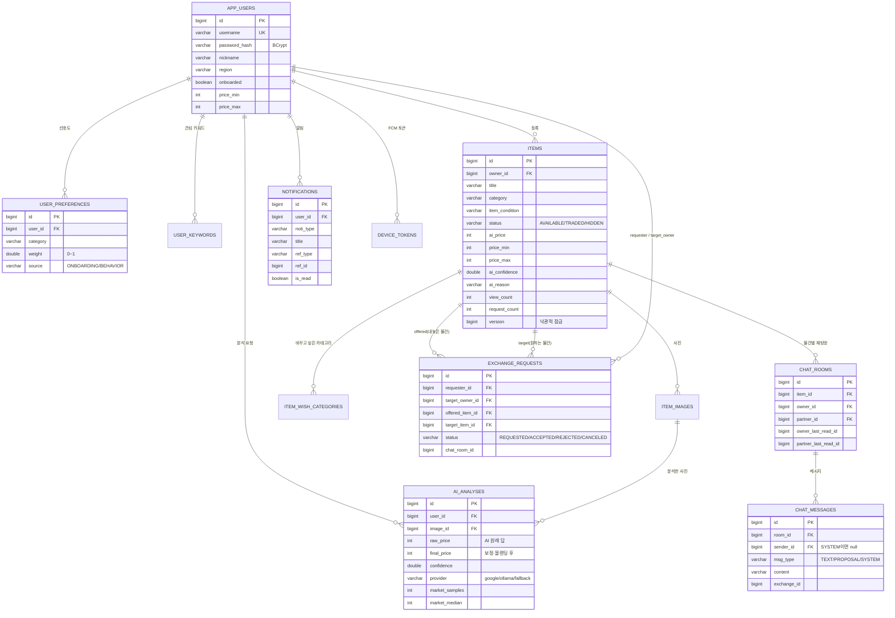

# 스바다 DB 설계

- DB: **H2 파일 DB** `sbada-server/data/sbada.mv.db` (서버를 껐다 켜도 남는다 — 4장 1.2)
- 테이블은 JPA 엔티티로부터 자동 생성(`ddl-auto=update`)
- 확인: 서버 실행 중 http://127.0.0.1:8097/h2-console → JDBC URL `jdbc:h2:file:./data/sbada`, User `sa`, 비밀번호 빈칸 (dev 프로필에서만 열림)

## ERD



## 테이블별 설명

| 테이블 | 무엇을 저장하나 | 설계 포인트 |
|---|---|---|
| `app_users` | 사용자 | 비밀번호는 **BCrypt 해시**만 저장(4장 3.4). 온보딩 희망 가격대 |
| `user_keywords` | 관심 키워드(최대 10개) | 제목에 들어 있으면 추천 +0.3 |
| `user_preferences` | 카테고리별 선호 가중치 | `(user_id, category)` **유니크** → 한 카테고리에 한 행. 학습할 때 UPDATE |
| `items` | 교환할 물건 | `ai_price` 는 클라이언트가 못 넣고 서버가 분석 결과에서 복사. `version` 으로 동시 수락 방지 |
| `item_wish_categories` | 이 물건과 바꾸고 싶은 카테고리 | 추천의 "상대 선호(상호성)" 에 쓰인다 |
| `item_images` | 사진 메타데이터 | 파일 자체는 `data/uploads/` 에 UUID 이름으로 |
| `ai_analyses` | AI 분석 기록 | AI 원래 답(`raw_price`)과 최종가(`final_price`)를 **둘 다** 남겨 보정이 얼마나 됐는지 설명 가능 |
| `exchange_requests` | 바로 바꾸기 요청 | 물건 2개 + 사람 2명. 상태 규칙은 `state-rules.md` |
| `chat_rooms` | 물건 1개 × 상대 1명 = 방 1개 | `(item_id, partner_id)` 유니크. 읽음 위치를 방에 저장해 "안 읽음 수"를 계산 |
| `chat_messages` | 메시지 | `PROPOSAL`(교환 제안 카드), `SYSTEM`("교환이 성사되었어요") 구분 |
| `notifications` | 알림함 | `is_read`, 누르면 이동할 대상(`ref_type`, `ref_id`) |
| `device_tokens` | FCM 기기 토큰 | 앱이 꺼져 있을 때 푸시용 |

## 인덱스 (알고리즘 속도)

| 인덱스 | 쓰는 곳 |
|---|---|
| `items(status, ai_price)` | **가격 매칭 1단계**: `status='AVAILABLE' AND ai_price BETWEEN ? AND ?` |
| `items(category)` | 카테고리 목록·앱 내 시세 중앙값 |
| `items(owner_id)` | 내 물건 |
| `exchange_requests(target_item_id, status)`, `(offered_item_id, status)` | 중복 요청 검사, 수락 시 겹친 요청 자동 취소 |
| `chat_messages(room_id, id)` | 방의 메시지를 순서대로 |
| `notifications(user_id, id)` | 내 알림 최신순 |

## 왜 물건을 DELETE 하지 않고 HIDDEN 으로 바꾸나
교환 요청·채팅방·AI 분석이 물건 id 를 참조합니다. 행을 지우면 "누구와 무엇을 바꿨는지" 기록이 깨지므로, 상태만 `HIDDEN` 으로 바꾸고 목록에서 뺍니다. 이때 걸려 있던 대기 요청은 자동 취소하고 상대에게 알립니다.

## 낙관적 잠금(@Version)이 필요한 장면
민지의 물건 하나에 준호와 서연이 동시에 요청 → 민지가 두 화면에서 거의 동시에 둘 다 수락.
두 트랜잭션이 같은 `items` 행을 바꾸려 하면 `version` 이 맞지 않는 쪽이 실패 → **409** 로 응답.
그래서 물건 하나는 **딱 한 번만** 교환됩니다.

## H2 콘솔에서 시연할 SQL

```sql
-- 비슷한 가격대 후보 (매칭 1단계와 같은 조건)
SELECT id, title, category, ai_price FROM items
 WHERE status = 'AVAILABLE' AND ai_price BETWEEN 25000 AND 100000 ORDER BY ai_price;

-- 민지의 선호도 (온보딩 1.0 + 행동 학습으로 오른 값)
SELECT u.nickname, p.category, ROUND(p.weight, 3) AS weight, p.source
  FROM user_preferences p JOIN app_users u ON u.id = p.user_id
 WHERE u.username = 'minji' ORDER BY p.weight DESC;

-- AI 원래 가격 vs 최종 가격
SELECT id, provider, raw_price, final_price, market_samples, market_median, confidence FROM ai_analyses ORDER BY id DESC;

-- 교환 요청 상태
SELECT id, requester_id, offered_item_id, target_item_id, status, close_reason FROM exchange_requests ORDER BY id DESC;
```
