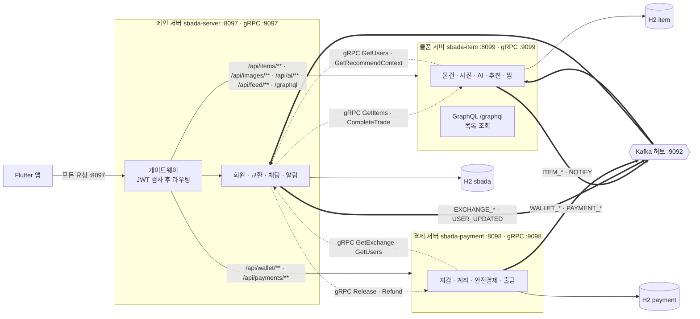

# 스바다 MSA — 2단계: 서버 3개(메인 · 물품 · 결제) + gRPC 배달부 + Kafka 허브 (2026-11-25)

> 1단계(결제 서비스 분리, 2026-11-20)는 아래 "1단계" 절에 그대로 둔다. 결제 · 지갑은 여전히 시연용(실제 돈 이동 없음).

## 한눈에



| 무엇 | 언제 쓰나 | 스바다에서 |
|---|---|---|
| **게이트웨이**(메인 8097) | 앱 → 서버 | 앱은 주소 하나만 안다. 물품 경로는 8099, 결제 경로는 8098 로 그대로 넘긴다(사진 업로드는 원본 바이트 그대로) |
| **gRPC 배달부** | 서버가 다른 서버에 "지금 답"을 물을 때 | `sbada-proto/proto/**.proto`. 메인 ↔ 물품(물건 정보, 거래 완료 표시, 회원 이름 · 추천 재료), 메인 ↔ 결제(정산 · 환불, 교환 조건) |
| **Kafka 허브** | "이런 일이 있었어" 알리기(답을 기다리지 않음) | 아웃박스 → 토픽 → 받는 쪽 멱등 처리. 물건 숨김 · 보류 → 메인이 대기 중 교환 자동 취소, 조회 → 취향 학습, 찜 · 보류 → 알림, 프로필 변경 → 물품 서버의 판매자 정보 갱신 |
| **GraphQL** | 앱이 물품 **목록**을 받을 때 | `items` · `myItems` · `myLikes` · `itemCount` · `categories` + `likedByMe`(BatchMapping 으로 한 번에). 필요한 칸만 받는다 |

### 서버별 DB(서로의 표를 직접 읽지 않는다)

| 서버 | DB | 마이그레이션 |
|---|---|---|
| 메인 | `sbada-server/data/sbada` | V19 `msa_split_items`: 물품 표로 가던 외래키를 끊고 `outbox_events` 추가(옛 물품 표는 옮겨 가기용으로 남김) |
| 물품 | `sbada-item/data/item` | V1: `sellers`(판매자 읽기 모델) · `items` · `item_images` · `ai_analyses` · `item_likes` · `outbox_events` · `processed_events` |
| 결제 | `sbada-payment/data/payment` | V1 · V2 (그대로) |

- **옛 데이터 옮기기**: 물품 서버가 처음 켜질 때 DB 가 비어 있으면 메인 서버 `GET /internal/legacy/items-export`(내부 토큰)를 한 번 받아
  같은 id 로 넣는다(30초마다 재시도, 메인 서버가 켜져 있어야 함). 그래서 교환 · 채팅에 남아 있는 물건 번호가 그대로 맞는다.
- **판매자 정보**: 물품 서버는 회원 표가 없다. `sellers` 읽기 모델을 `USER_UPDATED` 이벤트로 갱신하고, 처음 보는 사람은 gRPC `GetUsers` 로 채운다.

### 장애 격리
- 물품 서버가 꺼지면: 목록 · 등록 · 사진은 503 `ITEM_SERVICE_DOWN`, 교환 · 채팅 목록은 물건 칸만 "알 수 없음"으로 보이고 동작한다.
- 결제 서버가 꺼지면: 결제 API 만 503 `PAYMENT_SERVICE_DOWN`.
- Kafka 가 꺼지면: 각 서버의 `outbox_events` 에 쌓였다가 다시 켜지면 순서대로 보내진다(알림 · 자동 취소가 늦어질 뿐 잃어버리지 않음).

### 알려진 한계(다음 단계)
- 교환 성사: 메인이 gRPC `CompleteTrade` 로 두 물건을 거래 완료로 바꾼 뒤 자기 트랜잭션을 저장한다. 그 사이 메인이 실패하면
  물건만 거래 완료로 남을 수 있다(드묾). 보상 트랜잭션(사가)은 다음 단계.
- Render 무료 플랜 한 개로는 메인 서버만 뜬다 → 시연은 맥(.command) 또는 `docker compose up --build`.

### 실행
- 맥: `Kafka_설치_실행.command`(처음 한 번) → `스바다_실행.command` / `폰_USB_시연.command` 가 허브 · 세 서버를 함께 켠다(`scripts/start-msa-bg.sh`).
- 끄기: `scripts/stop-server.sh`(8097 · 8098 · 8099), Kafka 는 `brew services stop kafka`.
- 검사: `전체검사.command` 가 세 서버 테스트 + 앱 검사를 모두 돌린다.

---

# 1단계 — 결제 서비스 분리 (2026-11-20)

> 시연용: 실제 PG · 은행과 연결하지 않는다. 결제 · 출금은 결제 서비스 DB 안의 숫자만 바뀐다.

## 구조

```mermaid
flowchart LR
  APP[Flutter 앱] -->|모든 요청 :8097| GW
  subgraph CORE["메인 서버 sbada-server :8097"]
    GW[게이트웨이<br/>PaymentGatewayController<br/>JWT 검사 후 라우팅]
    SVC[회원 · 물건 · 교환 · 채팅 · 알림]
    IN[/internal/events<br/>/internal/users/{id}/]
  end
  subgraph PAY["결제 서비스 sbada-payment :8098"]
    W[지갑 · 계좌 · 결제 · 출금]
    OB[(아웃박스)]
    RELAY[OutboxRelay]
  end
  GW -->|/api/wallet/** · /api/payments/**| W
  GW --> SVC
  W --> OB --> RELAY -->|X-Internal-Token| IN --> SVC
  W -->|받는 사람 확인| IN
  SVC --> DB1[(H2 sbada)]
  W --> DB2[(H2 payment)]
```

| MSA 원칙 | 스바다에서 |
|---|---|
| 서비스별 독립 실행 · 배포 | `sbada-server`(8097) · `sbada-payment`(8098) 각각 jar · Dockerfile |
| 서비스별 DB | 메인 `data/sbada`, 결제 `sbada-payment/data/payment` — 서로의 표를 직접 읽지 않는다 |
| API 게이트웨이 | 앱은 8097 하나만 안다. `/api/wallet/**` · `/api/payments/**` 는 게이트웨이가 결제 서비스로 전달 |
| 인증 | 회원 서비스가 JWT 발급, 결제 서비스는 같은 키로 검증만(게이트웨이 + 서비스 이중 검사) |
| 이벤트 기반 통신 | 결제 서비스는 거래와 같은 트랜잭션에 아웃박스 이벤트를 쓰고, 릴레이가 메인 서버로 전달(at-least-once). 메인 서버는 `processed_events` 로 중복 제거(멱등) |
| 장애 격리 | 결제 서비스가 꺼져도 교환 · 채팅은 동작. 결제 API 만 503 `PAYMENT_SERVICE_DOWN` |
| 서비스 간 인증 | `X-Internal-Token`(gitignore 된 `data/.internal-token` 공유) |

규모가 커지면: 게이트웨이 → Spring Cloud Gateway / Nginx, 아웃박스 릴레이 → Kafka 프로듀서, 키 파일 → KMS.

## 결제 흐름(교환 추가 요금)

1. 채팅방 오른쪽 위 💳 → 상대가 요구한 금액 입력, 결제수단(카드 · 카카오페이 · 토스페이 · 계좌이체) 선택
2. **보내는 사람이 금액 + 수수료 5%** 를 결제 (예: 10,000원 → 10,500원)
3. 받는 사람 지갑에 10,000원 입금 + 알림 "추가 요금이 들어왔어요"
4. 받는 사람: 계정정보 → 지갑 → 계좌 선택 · 금액 입력 → 출금 → "출금되었습니다"

## 계좌번호 보호

- bcrypt 는 되돌릴 수 없는 해시라 비밀번호용. 계좌번호는 송금 때 원문이 필요해 **복호화 가능한 암호화**를 쓴다.
- 봉투 암호화: 계좌마다 새 AES-256-GCM 키로 암호화 → 그 키를 RSA-3072 OAEP(SHA-256) 공개키로 감싸 저장.
- RSA 개인키 · HMAC 키는 DB 가 아닌 `sbada-payment/data/keys/`(gitignore, 권한 600). DB 만 유출되면 계좌번호를 알 수 없다.
- DB 평문은 뒷자리(****1234)와 중복 확인용 HMAC-SHA256 지문뿐.

## 실제 서비스로 바꿀 때

개정 전자금융거래법(2024-09 시행): 구매 대금을 받아 셀러에게 정산하면 PG 등록 대상이 될 수 있다.
직접 등록 대신 PG사 **지급대행(정산대행)** 서비스를 쓰고, `WalletService.withdraw` 의 표시된 자리에서 PG API 를 부르면 된다.
