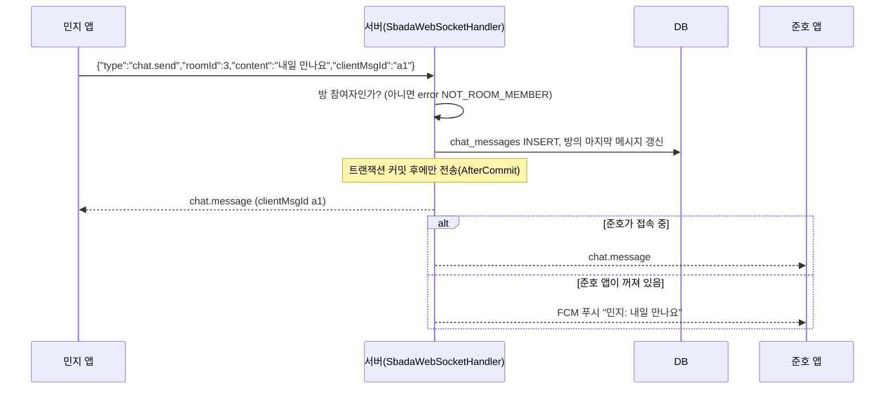

# 실시간 통신: WebSocket 채팅 · 푸시 알림

교재 1장 6절의 네 가지 방식 중 상황에 맞는 것을 골랐습니다.

| 상황 | 고른 방식 | 이유 |
|---|---|---|
| 채팅 (양쪽이 아무 때나 보냄) | **WebSocket** `/ws` | 연결을 유지하며 양방향 전송. 매번 HTTP 요청을 새로 만들지 않는다 |
| 앱이 켜져 있을 때의 알림 | **WebSocket** `notification` 이벤트 → Android 알림 표시줄 | 이미 열린 연결을 재사용 |
| 앱이 꺼져 있을 때의 알림 | **푸시(FCM)** | 모바일 OS가 백그라운드 연결을 끊으므로 OS의 푸시 서비스에 맡긴다 |
| 알림함·채팅 기록 처음 열기 | **REST** `GET /api/notifications`, `GET /api/chats/{id}/messages` | 지난 기록은 요청-응답이 맞다 |
| 연결이 끊긴 동안 | **REST로 대신 전송** + 재연결 후 다시 읽기 | WebSocket이 없어도 채팅이 멈추지 않는다 |

폴링은 쓰지 않았습니다. 5초마다 묻는 방식은 대부분의 요청이 "새 것 없음"이라 배터리와 서버를 낭비합니다.

## 연결

```
ws://10.0.2.2:8097/ws?token=<JWT>        (에뮬레이터)
ws://127.0.0.1:8097/ws?token=<JWT>       (PC에서 테스트)
```

1. 앱이 HTTP로 업그레이드 요청 → 서버가 **101 Switching Protocols** 로 동의
2. `JwtHandshakeInterceptor` 가 토큰을 검증. 없거나 틀리면 연결을 거절(401)
3. `RealtimeHub` 에 `userId → 세션들` 로 등록 (한 사람이 기기 여러 대로 접속 가능)
4. 서버가 `{"type":"hello","userId":1}` 을 보냄
5. 앱은 25초마다 ping 을 보내 연결이 살아 있는지 확인, 끊기면 1·2·4·8·16·30초 간격으로 재연결

## 메시지 프로토콜 (JSON 텍스트 프레임)

**앱 → 서버**

| type | 필드 | 설명 |
|---|---|---|
| `ping` | | 연결 확인 → `pong` |
| `chat.send` | `roomId`, `content`, `clientMsgId` | 메시지 보내기. `clientMsgId` 는 앱이 만든 임시 번호(응답과 짝짓기) |
| `chat.read` | `roomId` | 이 방을 여기까지 읽음 |

**서버 → 앱**

| type | 언제 |
|---|---|
| `hello` | 연결 직후 |
| `chat.message` | 방에 새 메시지(보낸 사람에게도 `clientMsgId` 와 함께 돌아가 "전송 중 → 전송됨"으로 바뀜) |
| `chat.read` | 상대가 읽음 → "1" 표시가 사라짐 |
| `notification` | 새 알림 → 앱이 Android 알림을 띄우고 배지 숫자 증가 |
| `exchange.updated` | 교환 요청 상태가 바뀜 → 채팅방의 제안 카드가 즉시 "수락됨" 등으로 바뀜 |
| `error` | `code`, `message`, `clientMsgId` (예: 방 참여자가 아니면 `NOT_ROOM_MEMBER`) |

## 메시지가 저장되고 전달되는 순서



**커밋 후 전송(AfterCommit)** 을 쓰는 이유: DB 저장이 실패했는데 상대 화면에 메시지가 먼저 뜨면, 다시 열었을 때 메시지가 사라지는 문제가 생깁니다.

## 알림이 화면에 뜨는 길 (푸시)

```
서버 NotificationService.notify()
  ① notifications 테이블에 저장 (알림함에서 다시 보기)
  ② 접속 중?  예 → WebSocket {"type":"notification"} 
               → Dart RealtimeClient → LocalNotifier → MethodChannel("sbada/notify")
               → MainActivity.kt NotificationManager → 안드로이드 상단 알림 표시줄
             아니오 → FcmPushSender (sbada.push.fcm.enabled=true 일 때) → Google FCM → 폰
```

- Android 13 이상은 알림 권한(`POST_NOTIFICATIONS`)을 실행 중에 묻습니다. 로그인 직후 한 번 요청합니다.
- 알림 채널 `sbada_default` 는 중요도 HIGH 라 화면 위에 잠깐 떠오릅니다(헤드업 알림).
- FCM 은 Firebase 서비스 계정 키가 필요하므로 기본은 꺼 두었습니다. 시연은 앱을 켜 둔 상태에서 WebSocket 경로로 충분히 보여 줄 수 있습니다.

## 알림 종류

| 종류 | 받는 사람 | 누르면 |
|---|---|---|
| `EXCHANGE_REQUESTED` 교환 요청이 왔어요 | 물건 주인 | 알림함에서 **수락 / 거절** 버튼 |
| `EXCHANGE_ACCEPTED` 교환이 성사되었어요 🎉 | 요청한 사람 | 채팅방 |
| `EXCHANGE_REJECTED` / `EXCHANGE_CANCELED` | 상대방 | 교환 상세 |
| `MATCH_SUGGESTED` 바꿀 만한 물건이 올라왔어요 | 비슷한 가격대 물건을 가진 상위 5명 | 물건 상세 |
| `CHAT_MESSAGE` | 상대방 (알림함에는 저장 안 함) | 채팅방 |

## 테스트

- `WebSocketChatTest` (JUnit): 실제 포트로 서버를 띄우고 두 사용자가 WebSocket으로 접속해 메시지가 오가는지, 잘못된 토큰의 연결이 401로 거절되는지, 교환 요청 알림이 실시간으로 오는지 확인합니다.
- 수동: 에뮬레이터에서 민지로 로그인 → cmd에서 `scripts\demo-send-request.bat` → 에뮬레이터에 알림이 뜨는지 확인.
