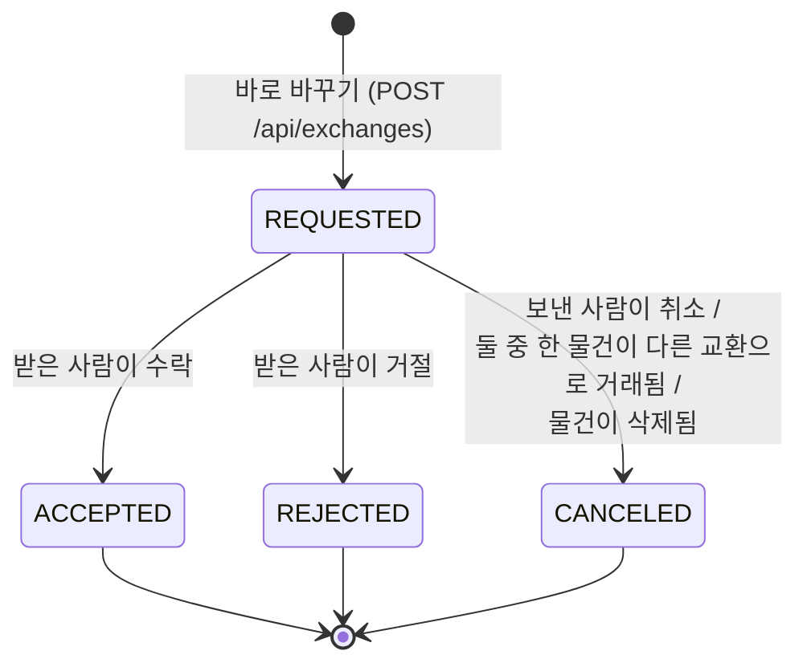

# 권한표 · 상태 규칙 · API 명세

교재 8장처럼 **허용할 행동을 표로 먼저 정하고**, 서버는 항상 **인증(401) → 존재(404) → 권한(403) → 상태(409)** 순서로 확인한 뒤에만 값을 바꿉니다.
응답 오류는 모두 `{"code":"...", "message":"..."}` 형식입니다.

## 1. 교환 요청 상태 규칙



- **수락은 받은 사람만** 할 수 있다 → 요청자는 상대 동의 없이 교환을 끝낼 수 없다(요구사항: "수락 버튼을 눌러야만 가능").
- 수락 순간: 두 물건 `AVAILABLE → TRADED`, 두 물건이 걸린 **다른 대기 요청은 모두 자동 CANCELED** + 알림.
- 끝난 요청(ACCEPTED·REJECTED·CANCELED)을 다시 수락/거절/취소 → **409 INVALID_STATUS**.
- 같은 조합으로 또 요청 → **409 DUPLICATE_REQUEST**. 상대가 반대 방향으로 이미 요청 → **409 REVERSE_REQUEST_EXISTS**("알림에서 수락해 주세요").
- 이미 TRADED 인 물건으로 요청 → **409 ITEM_NOT_AVAILABLE**.
- 동시에 두 요청을 수락 → `@Version` 충돌로 한쪽만 성공, 나머지 **409 CONCURRENT_UPDATE**.

## 2. 물건 상태

```
AVAILABLE ──(교환 수락)──▶ TRADED
AVAILABLE ──(삭제)──────▶ HIDDEN   (행은 남기고 목록에서 뺀다)
```

## 3. 권한표

| 행동 | 비로그인 | 로그인(남) | 등록자 / 받은 사람 | 보낸 사람 |
|---|---|---|---|---|
| 물건 목록·상세 보기 | 200 | 200 | 200 | — |
| 물건 등록 | 401 | 201 | — | — |
| 물건 수정·삭제 | 401 | **403 NOT_OWNER** | 200 / 204 | — |
| 내 물건의 가격 매칭 보기 | 401 | 403 NOT_OWNER | 200 | — |
| 교환 요청 보내기 | 401 | 201 (내 물건을 내놓을 때만) | 400 SELF_EXCHANGE | — |
| 교환 수락·거절 | 401 | 403 NOT_RECEIVER | **200** | 403 NOT_RECEIVER |
| 교환 취소 | 401 | 403 NOT_REQUESTER | 403 NOT_REQUESTER | **200** |
| 채팅방 메시지 읽기·보내기 | 401 | 403 NOT_ROOM_MEMBER | 200 | 200 |
| AI 분석 결과로 등록 | 401 | 403 NOT_ANALYSIS_OWNER (남의 분석) | 201 | — |

**서버가 정하는 값은 본문에서 받지 않는다(7장)**: `price`, `status`, `ownerId` 등을 본문에 넣으면 **400 UNKNOWN_FIELD**. 등록자는 JWT 에서 꺼낸다.

## 4. API 명세

기본 주소: PC `http://127.0.0.1:8097` · 에뮬레이터 `http://10.0.2.2:8097` · 🔒 = `Authorization: Bearer <JWT>` 필요

### 인증·사용자
| 메서드 | 경로 | 설명 |
|---|---|---|
| POST | `/api/auth/signup` | 가입 `{username, password, nickname, region}` → 201 (이미 있으면 409) |
| POST | `/api/auth/login` | 로그인 → `{accessToken, tokenType, expiresIn, user}` (틀리면 401) |
| GET 🔒 | `/api/me` | 내 정보 + 선호도 + 온보딩 여부 |
| PUT 🔒 | `/api/me/preferences` | **온보딩 저장** `{wantedCategories[], keywords[], priceMin, priceMax}` |
| GET | `/api/categories` | 카테고리 14개(라벨·이모지·기준가) |

### 사진·AI
| 메서드 | 경로 | 설명 |
|---|---|---|
| POST 🔒 | `/api/images` | 사진 업로드(multipart `file`, 5 MiB, PNG/JPEG) → `{id, url}` |
| GET | `/api/images/{id}` | 사진 보기 |
| POST 🔒 | `/api/ai/analyze` | **Gemma 가격 분석** `{imageId, title?, category?, condition?}` → 가격·범위·근거·신뢰도 |
| GET | `/api/ai/status` | 지금 쓰는 AI(google/ollama/fallback) |

### 물건·추천
| 메서드 | 경로 | 설명 |
|---|---|---|
| GET | `/api/items?category=&q=&limit=` | 목록 |
| GET | `/api/items/{id}` | 상세(로그인 상태면 선호도 학습 +0.03) |
| POST 🔒 | `/api/items` | 등록 `{title, description, category, condition, imageIds[], analysisId, wishCategories[]}` — 가격 필드 없음 |
| PUT 🔒 | `/api/items/{id}` | 수정(등록자만) |
| DELETE 🔒 | `/api/items/{id}` | 삭제 → HIDDEN, 대기 요청 자동 취소 |
| GET 🔒 | `/api/me/items` | 내 물건 |
| GET 🔒 | `/api/items/{id}/matches?limit=` | **가격 매칭**(점수·요소·이유) |
| GET 🔒 | `/api/feed?limit=` | **홈 추천 피드** |

### 교환 (바로 바꾸기)
| 메서드 | 경로 | 설명 |
|---|---|---|
| POST 🔒 | `/api/exchanges` | 요청 `{targetItemId, offeredItemId, message?}` → 201, 상대에게 알림 |
| GET 🔒 | `/api/exchanges?box=received\|sent` | 받은/보낸 요청 |
| GET 🔒 | `/api/exchanges/{id}` | 상세(당사자만) |
| POST 🔒 | `/api/exchanges/{id}/accept` | **수락**(받은 사람만) |
| POST 🔒 | `/api/exchanges/{id}/reject` | 거절(받은 사람만) |
| POST 🔒 | `/api/exchanges/{id}/cancel` | 취소(보낸 사람만) |

### 채팅·알림
| 메서드 | 경로 | 설명 |
|---|---|---|
| POST 🔒 | `/api/chats` | 물건으로 채팅 시작 `{itemId}` (있으면 기존 방) |
| GET 🔒 | `/api/chats` | 내 채팅방(안 읽은 수 포함) |
| GET 🔒 | `/api/chats/{roomId}/messages?afterId=` | 지난 메시지 |
| POST 🔒 | `/api/chats/{roomId}/messages` | WebSocket이 끊겼을 때 REST로 보내기 |
| POST 🔒 | `/api/chats/{roomId}/read` | 읽음 |
| WS | `/ws?token=JWT` | **실시간 채팅·알림** (`realtime.md`) |
| GET 🔒 | `/api/notifications` · `/unread-count` | 알림함 · 배지 숫자 |
| POST 🔒 | `/api/notifications/{id}/read` · `/read-all` | 읽음 |
| POST 🔒 | `/api/devices` | FCM 기기 토큰 등록 |
| GET | `/api/health` | 서버 상태(DB·AI·접속자 수) |

## 5. 이 규칙을 검사하는 테스트

| 테스트 | 확인하는 것 |
|---|---|
| `AuthApiTest` | 가입·로그인, 토큰 없음 401, 변조 토큰 401 |
| `ItemExchangeFlowTest` | 가격 몰래 넣기 400, 남의 물건 수정 403, 요청 → 수락 → TRADED, 끝난 요청 재수락 409, 겹친 요청 자동 취소 |
| `WebSocketChatTest` | 실시간 채팅·알림 전달, 잘못된 토큰 연결 거절 |
| `PriceSanitizerTest` · `ScoreMathTest` | 가격 보정·추천 점수 공식 |
| `scripts/smoke-test.bat` | 실행 중인 서버에 cmd + curl 로 11가지 요청 |
